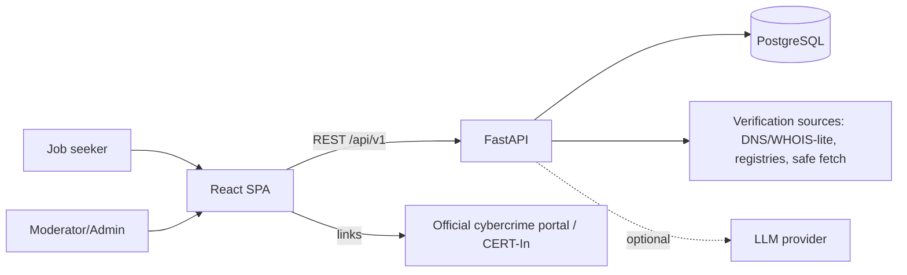
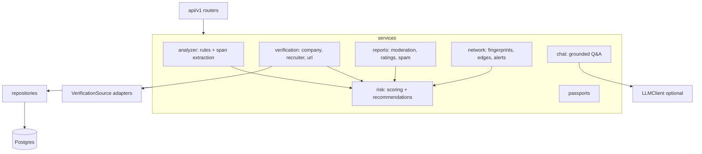

# 04 — Architecture

## 1. Context


## 2. Backend modules


## 3. Analysis request flow (Journey A)
1. `POST /analyze/job` validates input, creates `job_posting`.
2. Analyzer produces flags with spans + missing info.
3. If company/domain supplied, verification service runs enabled checks (concurrently, timeouts); results stored in `verification_checks`.
4. Network service computes fingerprints and checks similarity (P1).
5. Risk engine merges evidence (dedupe), computes score/band/unknowns/recommendations, stamps `rules_version`.
6. Persist `job_analyses`, `risk_factors`, `safety_recommendations`; return `AnalysisResult`.

## 4. Verification source contract
```python
class VerificationResult(BaseModel):
    check_type: str
    status: Literal["information_found","consistent","mismatch","inconclusive","not_checked"]
    matched_fields: list[str]; mismatched_fields: list[str]; unknown_fields: list[str]
    source_url: str | None; checked_at: datetime; details: dict
```
Adapters: `DomainConsistencyCheck`, `LookalikeDomainCheck`, `SafeFetchCheck`, `RegistryLookupCheck` (config-gated), `CommunityReportLookup`. Any exception → `inconclusive` with `details.error_class` (no stack traces).

## 5. Moderation state machine (reports)
`pending_review → under_review → {evidence_requested ↔ under_review} → {substantiated | inconclusive | rejected}`; `removed` reachable from any state by moderator. Every transition writes `moderation_actions` + `audit_logs`.

## 6. Watchlist state machine
`unverified_signal → under_review → {confirmed_pattern | cleared}`; `confirmed_pattern` requires moderator role; appeals reopen to `under_review`.

## 7. Frontend structure
Feature-sliced: `features/analyzer`, `verification`, `reports`, `network`, `dashboard`, `passport`, `chat`, `admin`, `resources`. Shared `components/ui` (Badge, StatusLabel, EvidenceList, UnknownsList, RiskMeter, EmptyState, ErrorState, Skeleton). Server state via TanStack Query; local UI state minimal; theme/lang in providers.

## 8. Cross-cutting
Request-ID middleware → structured logging (no PII) → rate limiter → auth dependency → RBAC dependency → handler → problem-JSON error mapper → audit logger for protected actions.

## 9. Deployment sketch
Web on Vercel (static, `VITE_API_BASE_URL`), API container on Python host, managed Postgres; secrets via host env; CORS locked to web origin; HTTPS only.
