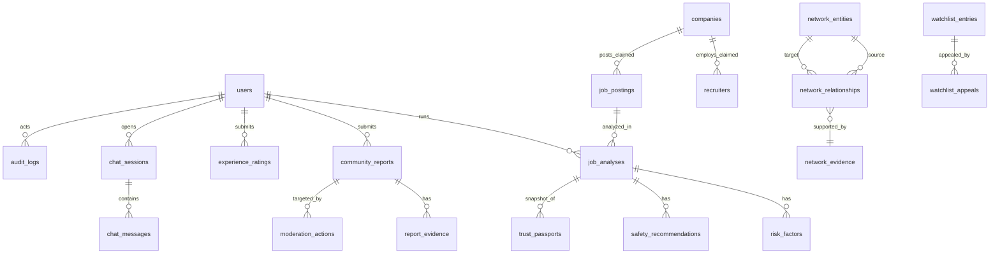

# 05 — Database Design

PostgreSQL 16. UUID PKs (`gen_random_uuid()`), `created_at/updated_at timestamptz`, FKs with explicit ON DELETE, Alembic migrations only. Demo rows carry `is_synthetic boolean default false`.

## ER diagram

## Tables (key columns)
| Table | Columns / notes |
|---|---|
| users | id, name, email (unique, citext), password_hash (argon2), role enum(user,moderator,admin), preferred_language, explanation_language, theme enum(light,dark,system), is_active, created_at |
| companies | id, name, normalized_name, website, normalized_domain (idx), registration_reference, verification_status, is_synthetic |
| recruiters | id, claimed_name, claimed_role, company_id FK, contact_hash, email_domain, verification_status |
| job_postings | id, company_id FK null, title, description, salary_text, location, source_url, description_fingerprint, submitted_by FK, created_at |
| job_analyses | id, user_id FK, job_id FK, risk_score smallint 0-100 null, risk_band, assessment_type, summary, explanation, rules_version, input_summary, supersedes_id FK null, created_at |
| risk_factors | id, analysis_id FK cascade, factor_code, severity enum, confidence enum, evidence_excerpt, span_start, span_end, explanation, source_type, source_id, evidence_key (for dedupe) |
| verification_checks | id, entity_type, entity_id, check_type, status enum(5), matched/mismatched/unknown jsonb, source_url, checked_at, details jsonb |
| community_reports | id, user_id FK, company_id FK, job_id FK null, category enum, description, occurred_on, interacted/paid/shared flags, moderation_status enum(7), public_summary (redacted, moderator-approved), pii_flagged bool, created_at |
| experience_ratings | id, user_id, company_id, job_id, rating 1-5, dimensions_json, review_text, moderation_status, spam_score; unique(user_id, company_id, job_id) |
| report_evidence | id, report_id FK, storage_key, file_type, size, redaction_status enum(pending,redacted,rejected) |
| network_entities | id, entity_type enum(job,company,recruiter,email_domain,website_domain,phone,payment,template,report), protected_value_hash (HMAC), visibility_level enum(restricted,internal), first_seen, last_seen |
| network_relationships | id, source_entity_id, target_entity_id, relationship_type, evidence_id, confidence numeric, review_status, created_at; unique(source,target,type) |
| network_evidence | id, kind, similarity numeric, detail jsonb, record_refs jsonb |
| watchlist_entries | id, entity_reference, status enum(unverified_signal,under_review,confirmed_pattern,cleared), reason, evidence_reference, source, confidence, reviewer_id FK, reviewed_at |
| watchlist_appeals | id, entry_id FK, submitted_by, message, status, resolved_by, resolved_at |
| safety_recommendations | id, analysis_id FK, recommendation_code, text_key (i18n), priority |
| trust_passports | id, analysis_id FK, public_token_hash (unique), expires_at, revoked_at, created_by |
| chat_sessions | id, user_id FK, analysis_id FK null (optional grounding), title, created_at, updated_at |
| chat_messages | id, session_id FK cascade, role (user/assistant), content, source_references jsonb (evidence ids cited), statement_types jsonb (fact/user_report/ai_interpretation), mode (templated/llm), created_at |
| moderation_actions | id, moderator_id, target_type, target_id, action, reason, private_note (restricted), created_at |
| audit_logs | id, actor_id, action, resource_type, resource_id, ip_hash, timestamp (append-only) |
| saved_opportunities, checklist_progress | user-scoped dashboard helpers (P1) |

## Indexes
companies(normalized_domain), companies(normalized_name trigram), job_postings(description_fingerprint), community_reports(company_id, moderation_status), network_entities(entity_type, protected_value_hash) unique, risk_factors(analysis_id), audit_logs(resource_type, resource_id, timestamp). Optional `vector` column on job_postings (P2).
## Safeguards and retention
No plaintext passwords/OTPs/ID numbers/bank details. Evidence files in private storage with signed short-lived access, moderator-only. Contact identifiers stored only as HMAC hash (+ encrypted raw only if justified by ADR). User deletion: anonymize or delete submissions per policy; audit logs retain actor id only. Default retention (configurable): unapproved evidence 90 days, rejected reports 180 days, analyses until user deletes.
Chat: a message that contains credential material (password, OTP, PIN, banking details, unredacted ID number) is refused and **never persisted**; the session stores only the assistant's warning. Instruction-like content in a user message is stripped before storage and is always treated as data, never as an instruction.
